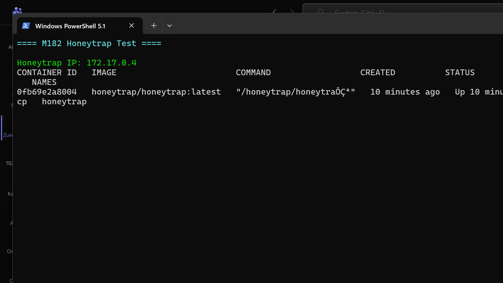
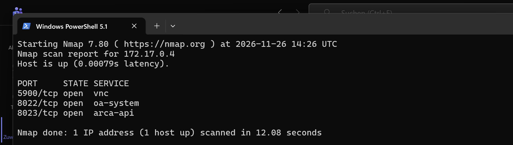
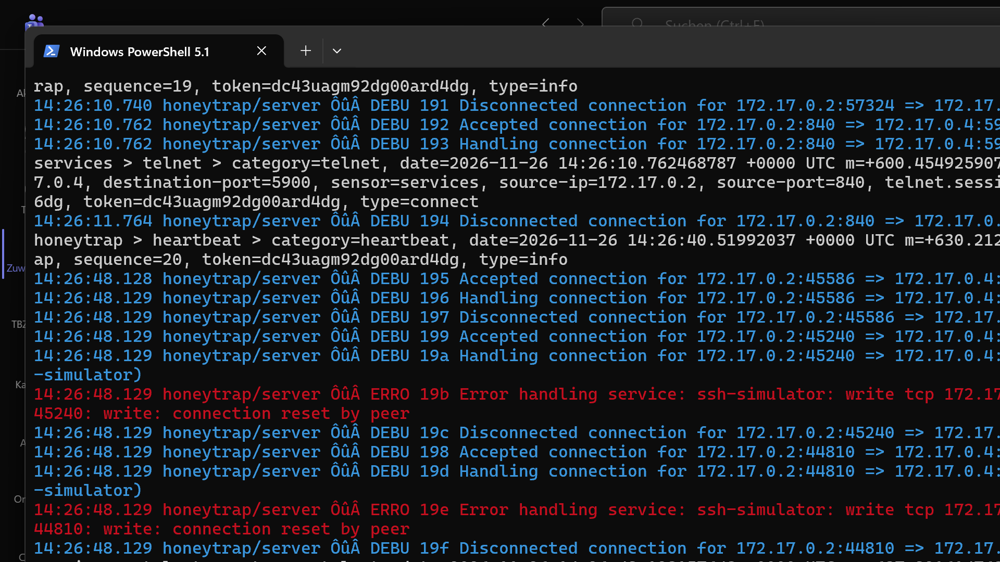

# M182 Auftrag: Honeypots mit Honeytrap

## Inhalt

1. [Ausgangslage](#1-ausgangslage)
2. [Lab-Umgebung](#2-lab-umgebung)
3. [Installation](#3-installation)
4. [Testing](#4-testing)
5. [Erkenntnisse](#5-erkenntnisse)
6. [Vergleich mit Cowrie](#6-vergleich-mit-cowrie)
7. [Fazit](#7-fazit)
8. [Quellen](#8-quellen)

---

## 1. Ausgangslage

Ein Honeypot ist ein absichtlich verwundbares oder nachgemachtes System, das keine echte Aufgabe hat. Es steht nur da, um Angreifer anzulocken und aufzuzeichnen, was sie tun. Weil niemand einen echten Grund hat, sich mit einem Honeypot zu verbinden, ist jede Verbindung darauf verdächtig.

In diesem Auftrag installiere ich den Honeypot Honeytrap, lasse ihn laufen und greife ihn aus meinem Angreifer-Container an. Danach schaue ich im Log nach, was der Honeypot alles mitbekommen hat.

Honeytrap ist ein Low-Interaction-Honeypot, der Angriffe gegen Netzwerkdienste beobachtet. Low-Interaction heisst, er simuliert die Dienste nur, statt echte Dienste laufen zu lassen. So kann der Angreifer das System nicht wirklich übernehmen.

## 2. Lab-Umgebung

Alles läuft lokal in Docker im selben Netz wie schon bei den früheren Übungen.

| Rolle | Container | Image | IP-Adresse |
|-------|-----------|-------|------------|
| Angreifer | `hardeninglab` | ubuntu:22.04 (mit nmap und netcat) | 172.17.0.2 |
| Honeypot | `honeytrap` | honeytrap/honeytrap:latest | 172.17.0.4 |

Netzwerk: 172.17.0.0/24

## 3. Installation

Honeytrap gibt es als fertiges Docker-Image, darum ist die Installation kurz.

**Schritt 1: Image holen**

```bash
docker pull honeytrap/honeytrap:latest
```

**Schritt 2: Honeypot starten**

```bash
docker run -d --name honeytrap honeytrap/honeytrap:latest
```

**Schritt 3: Prüfen, dass er läuft**

```bash
docker ps
docker inspect -f "{{range .NetworkSettings.Networks}}{{.IPAddress}}{{end}}" honeytrap
```

Der Container läuft und bekommt die IP 172.17.0.4. Beim Start liest Honeytrap seine Konfiguration aus `/config/config.toml`. Im Log sieht man, welche Dienste und Ports er aufmacht:

```
Configured service ssh-simulator (ssh-simulator)
Configured service telnet (telnet)
Listener started: tcp/:8022
Listener started: tcp/:8023
Listener started: tcp/:5900
```

Honeytrap simuliert also einen SSH-Dienst und einen Telnet-Dienst und lauscht auf den Ports 8022, 8023 und 5900.



## 4. Testing

Jetzt spiele ich den Angreifer und gehe vom Container `hardeninglab` aus auf den Honeypot los.

**Portscan mit nmap**

```bash
nmap -Pn -sT -p 8022,8023,5900 172.17.0.4
```

Ergebnis: alle drei Ports sind offen.

```
PORT     STATE SERVICE
5900/tcp open  vnc
8022/tcp open  oa-system
8023/tcp open  arca-api
```

Die Dienstnamen (vnc, oa-system, arca-api) sind nur die Standard-Namen, die nmap zu diesen Portnummern kennt. Dahinter stecken in Wahrheit die simulierten Dienste von Honeytrap.

**Verbindungen auf die Dienste**

Zusätzlich habe ich mich mit netcat direkt auf die Ports verbunden und Daten geschickt, um Verbindungen und Login-Versuche zu erzeugen.



## 5. Erkenntnisse

Das Spannende ist das Log vom Honeypot. Honeytrap hat jeden einzelnen Zugriff protokolliert. Für jede Verbindung steht im Log, von wem sie kam, auf welchen Port und welchen simulierten Dienst sie ging.

```
Accepted connection for 172.17.0.2:45922 => 172.17.0.4:8022 ssh-simulator
Accepted connection for 172.17.0.2:43392 => 172.17.0.4:5900 telnet
services > telnet > source-ip=172.17.0.2, destination-port=5900, type=connect
services > telnet > source-ip=172.17.0.2, telnet.username=..., type=password-authentication
```

Meine wichtigsten Erkenntnisse:

- Der Honeypot hat die **IP des Angreifers (172.17.0.2)** sauber mitgeschrieben, dazu den Quellport, den Zielport und den angesprochenen Dienst.
- Für jede Verbindung gibt es eine eigene **Session-ID**, so kann man einzelne Angriffe auseinanderhalten.
- Honeytrap hat nicht nur die Verbindung protokolliert, sondern auch die **gesendeten Daten** (zum Beispiel den Login-Versuch als `type=password-authentication`).
- Es gab **keine echten Dienste** dahinter. Der Angreifer verbindet sich nur mit einer Simulation und kann dem echten System nichts anhaben.
- Weil der Honeypot keine normale Aufgabe hat, ist **jede Verbindung automatisch verdächtig**. Man muss die Logs nicht gross filtern, alles was ankommt, ist potenziell ein Angriff.



## 6. Vergleich mit Cowrie

Mein Kollege Aldin hat für denselben Auftrag Cowrie genommen, einen SSH- und Telnet-Honeypot mit mittlerer Interaktion. So können wir die zwei gut vergleichen.

Bei Cowrie kann sich der Angreifer sogar einloggen und landet in einer nachgebauten Shell. Adlin hat von Kali aus getestet: Der Login `root/123456` wurde abgelehnt, `root/hunter2` hat geklappt. Danach konnte er Befehle absetzen wie `id`, `whoami`, `ls`, `cat /etc/passwd` und sogar einen Download mit `wget`. Cowrie hat die angreifende IP, alle probierten Benutzer und Passwörter und jeden einzelnen Befehl samt Download-Versuch mitgeloggt.

Honeytrap arbeitet anders. Es simuliert die Dienste nur und lässt keine echte Shell zu. Dafür fängt es mehrere Ports und Dienste gleichzeitig ab.

| | Cowrie (Aldin) | Honeytrap (ich) |
|---|---|---|
| Interaktion | mittel, echte Fake-Shell | niedrig, nur Simulation |
| Abdeckung | nur SSH und Telnet | mehrere Ports und Dienste |
| Was man sieht | genau was der Angreifer tippt (Befehle, Downloads) | von wo auf welche Dienste zugegriffen wird |
| Stärke | Tiefe | Breite |

Kurz gesagt: Cowrie geht in die Tiefe, man sieht genau, was der Angreifer in der Shell macht. Honeytrap geht in die Breite, man sieht, wo überall geklopft wird. Am besten kombiniert man beide, dann hat man die Breite von Honeytrap und die Detailtiefe von Cowrie.

## 7. Fazit

Die Installation von Honeytrap über Docker ist einfach und schnell. Schon mit der Standard-Konfiguration simuliert er SSH und Telnet und schreibt jeden Zugriff genau mit. Im Test hat er meinen Portscan und meine Verbindungen vom Angreifer-Container komplett erfasst, inklusive IP, Ports und der gesendeten Daten.

Ein Honeypot ersetzt keine Firewall und keine Absicherung, aber er ist ein gutes Frühwarnsystem. Er zeigt, dass jemand im Netz herumschnüffelt, bevor dieser an die echten Systeme kommt, und das ohne Risiko für die produktive Umgebung.

## 8. Quellen

- Honeytrap Quick Start (offizielle Doku): https://honeytrap.github.io/honeytrap-docs/about/quick-start
- Honeytrap Konfiguration: https://honeytrap.github.io/honeytrap-docs/manuals/config/
- Honeytrap auf GitHub: https://github.com/honeytrap/honeytrap
